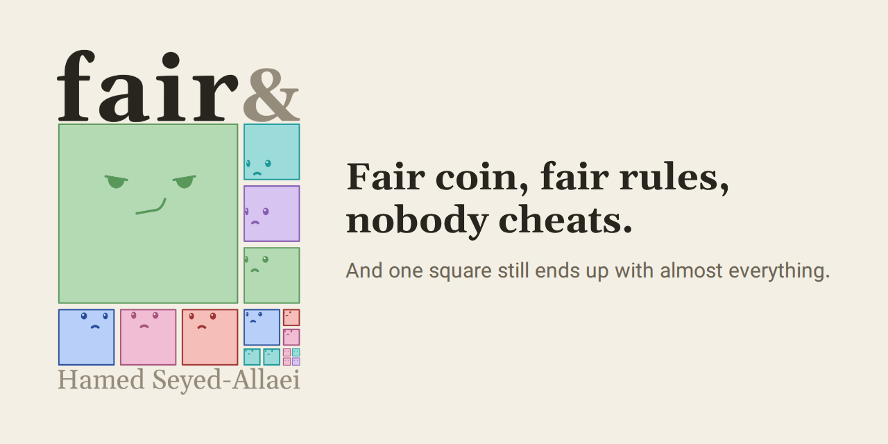
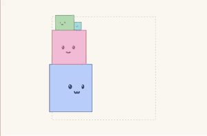
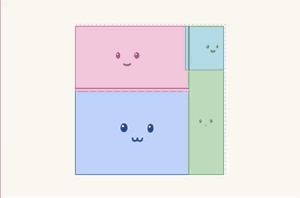
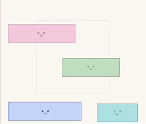

<p align="center">
  <a href="https://hamed.github.io/fair-and-square/"></a>
</p>

<p align="center"><b><a href="https://hamed.github.io/fair-and-square/">▶ Play Fair and Square</a></b></p>

Fair coin, fair rules, nobody cheats, and one square still ends up with almost everything.

**Fair and Square** is the Yard-Sale model, played with squares. Each square's area is its money. Every trade is a
fair coin flip. The charts are made of the squares themselves.

| The Gini | The effective number | Who has at least |
| :---: | :---: | :---: |
|  |  |  |
| Stairs of squares: the gap over the triangle | Sides as shares: copies of the pile that fill the box | Bars on a log scale: a line that counts |

## Inside

- **Learn**: four short acts, from two squares and a coin to a tax and choosing a yard before you know who you'll be.
- **Play**: stake, tax, speed and how many squares; the Gini, the effective number, Lorenz and who has at least, live.
- **Build**: the rules as blocks. Change them, and share the yard as a link.
- **[About](https://hamed.github.io/fair-and-square/about.html)** and **[How it was made](https://hamed.github.io/fair-and-square/making-of.html)**.

## Run it

```sh
npm install
npm run dev     # the stage, with hot reload
npm test        # the model, the stage, Learn, the pages
npm run build   # dist/, ready for any static host
```

Every push to `main` deploys to GitHub Pages (`.github/workflows/deploy.yml`). Developer notes:
[the stage and its console](docs/development.md) · [Learn](docs/story-spec.md) ·
[the model and its blocks](docs/model-blocks-spec.md) · [the brand](docs/brand.md).

Promotion and measurement: [private campaign links](docs/campaigns.md) · [analytics events](docs/analytics.md).

## Thanks

The model is not mine: Anirban Chakraborti wrote it down and Brian Hayes named it, both in 2002; Bruce Boghosian and
colleagues worked out its equations ([2014](https://arxiv.org/abs/1407.6851), [2015](https://arxiv.org/abs/1412.7227));
Christoph Börgers and Claude Greengard [proved](https://arxiv.org/abs/2308.01485) where it ends. Made by
[Hamed Seyed-Allaei](https://hamed.github.io/fair-and-square/about.html), with help from AI coding assistants. Type:
Gelasio and Vazirmatn (SIL Open Font License, in `stage/fonts/`).

## Support

If you think “fair and square” makes our world a slightly better place to live, a small gift warms my heart, and big
ones warm my home. Both encourage me to do more: [Ko-fi](https://ko-fi.com/P5P1S2R6S) ·
[PayPal](https://paypal.me/hamedallaei).
